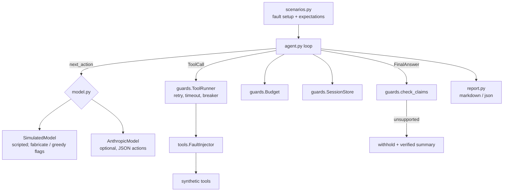

# agent-reliability-lab

A runnable playground for the boring, decisive parts of tool-using AI agents: what happens when a tool fails, hangs, or the model says something it never checked. Seven fault-injection scenarios run in under a second, offline, and produce a report that shows observed behaviour against stated expectations.

> Tools, catalog data, and faults are synthetic. The default planner is a scripted policy, labelled `simulated` everywhere; it is not a language model. This is a portfolio project built from public knowledge and is not an employer project.

## Who it is for and what problem it solves

**Audience:** engineers putting an agent loop in front of real users, and the leads reviewing their design.

**Problem:** agent demos are judged on the happy path, but incidents come from everything else: a flaky upstream, a request that never returns, a model that pads an answer with a plausible number, a loop that burns budget, state that bleeds between users. These failure modes are well known individually; what is rarely shown is a small, complete loop where every guard is implemented, exercised, and reported together.

**MVP scope (complete):**
- A minimal agent loop (`model proposes, guards dispose`) over three synthetic tools
- Guards: retry with backoff for retryable errors, hard timeout that is never retried, per-tool circuit breaker, tool-call / turn / wall-clock budget, per-session memory with no cross-session read path, claim checker that withholds numbers and SKUs absent from tool evidence
- Fault injector: fail N times, fail forever, hang
- Seven scenarios with explicit expectations, a markdown + JSON report, and a `--strict` mode for CI
- Optional real-model planner; the same guards apply to it and its answers are claim-checked

## Stack and why

- **Python 3.10+, standard library only.** Threads for timeouts, dataclasses for structure, no framework. The point is that the guards are a few hundred readable lines, not a dependency.
- **pytest + GitHub Actions**; CI runs the scenarios with `--strict` and uploads the report as an artifact.
- **`anthropic` SDK as an optional extra.** The lab is about the loop around the model, so the model is swappable and optional.

## Quick start (no credentials needed)

```bash
pip install -e ".[dev]"
agent-lab list
agent-lab run --report reports/latest.md
agent-lab run --scenario tool-timeout --json
make test
```

### Optional: real planner

```bash
cp .env.example .env    # git-ignored
pip install -e ".[llm]"
export AGENT_LAB_MODEL_PROVIDER=anthropic ANTHROPIC_API_KEY=... AGENT_LAB_MODEL=<model id>
agent-lab run
```

The real model replaces the planner in the five well-behaved scenarios. `unsupported-claim` and `budget-limit` keep their scripted misbehaving planners because the point of those scenarios is to inject the misbehaviour deterministically. Whatever the real model answers is still passed through the claim checker (there is a test for exactly this: a fake model answering "$999" gets its answer withheld).

## Walkthrough (actual output)

```
$ agent-lab run --report reports/latest.md
PASS  happy-path               status=ok
PASS  tool-transient-failure   status=ok
PASS  tool-permanent-failure   status=degraded
PASS  tool-timeout             status=degraded
PASS  unsupported-claim        status=unsupported-claim
PASS  budget-limit             status=budget-exceeded
PASS  session-isolation        status=ok

7/7 scenarios passed
report written to reports/latest.md
```

From the report, the scenario where the scripted planner fabricates a stock figure:

| Check | OK | Observed |
|---|---|---|
| status unsupported-claim | yes | `unsupported-claim` |
| fabricated number flagged | yes | `ClaimReport(unsupported_numbers=['2'], unsupported_skus=[])` |
| fabrication withheld from answer | yes | `[withheld: the draft answer contained claims not backed by tool results: ['2']] Verified facts only: search 'Cedar Footrest' -> ['sku-300']; sku-300 price $35.00` |
| verified price still delivered | yes | (same) |

And the permanent-failure scenario, where the honest outcome is to say so:

> Final answer: `I could not complete this: get_price: upstream unavailable. No figures are available.`
> Tool call sequence: `search_catalog, get_price, get_price, get_price`

The full report is in [`reports/latest.md`](reports/latest.md).

## Architecture



## Design tradeoffs and things learned building it

- **Timeouts cannot kill Python threads.** The first version used `ThreadPoolExecutor`; a 5-second simulated hang made the whole run take 5 seconds because non-daemon workers block interpreter exit. The fix is a daemon thread, and the real lesson is written into the docstring: cancellation has to live at the I/O layer. The hang is also deliberately **not retried**, since retrying a hang multiplies the damage.
- **Claim checking is lexical, on purpose.** It compares numbers and SKUs against tool output. That is crude but has no false negatives for the thing it checks and runs in microseconds. It had one false positive during development, flagging `300` inside `sku-300`, which is now a regression test.
- **Budget counts attempts, not logical calls.** A retrying tool can exhaust the budget on its own. That is intentional: retries are real cost.
- **Degraded is a first-class status.** Returning "I could not complete this" with `status=degraded` beats returning a guess with `status=ok`; callers can branch on it.
- **Session memory has no enumerate-all API.** Isolation by construction rather than by discipline.
- **Scenarios carry their expectations as code**, so the report cannot drift from what is actually asserted, and `--strict` makes CI fail on regressions.

## Limitations

- Single-process, in-memory, synchronous. No persistence, no concurrency between sessions (the store is lock-protected but the scenarios run serially).
- The simulated planner follows one fixed plan shape (search, price, answer). It demonstrates guards, not planning quality.
- The claim checker does not validate prose claims ("ships in 3 days" is only caught because of the number).
- Backoff and timeouts are tuned for fast demos (10 ms, 0.5 s), not production.
- The real-model path was tested against fake clients, not a live API, in this repository's verification run.

## Verification

Run on Python 3.12.3, 2026-10-27:

```
$ python -m pytest --cov=agent_lab --cov-report=term-missing
36 passed in 0.96s
TOTAL  471 stmts  13 miss  97% coverage

$ agent-lab run --strict
7/7 scenarios passed   (0.33 s wall clock)
```

guards.py, scenarios.py, and report.py are at 100%; uncovered lines are the real-SDK construction path in model.py and a tool branch not reachable through the injector. Tests cover each guard in isolation, every scenario end to end, a fake real-model client that fabricates (caught), returns non-JSON (reported), and raises (reported), plus CLI exit codes including `--strict`.

## License

MIT
